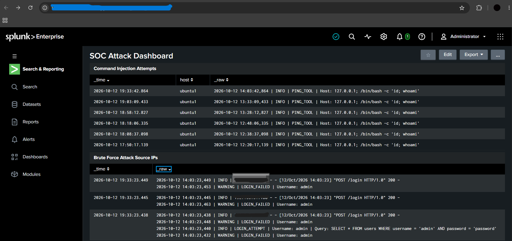
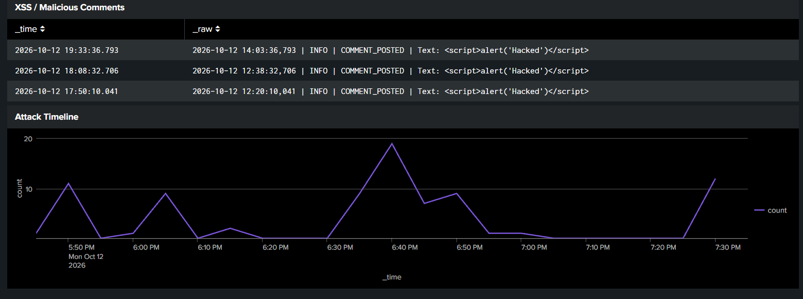
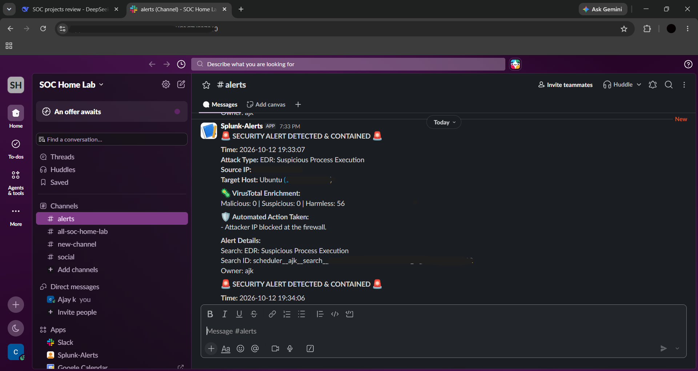
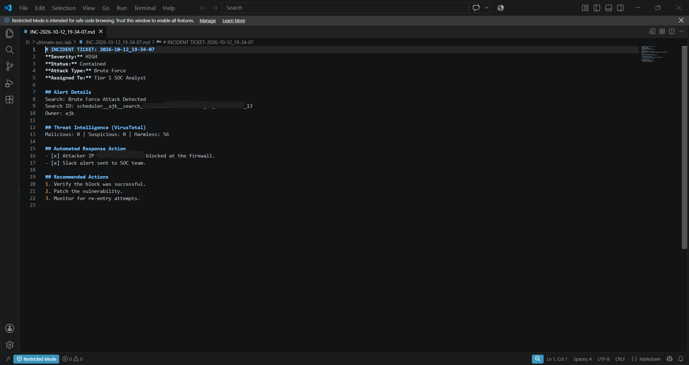
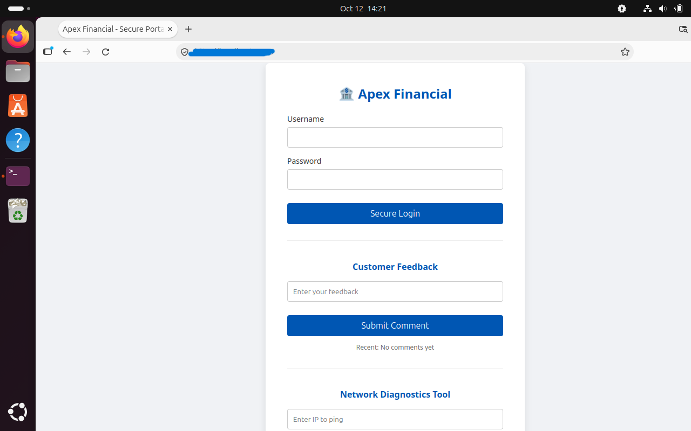

# SIEM & SOAR Web Attack Detection Lab

## 📌 Project Overview
This project demonstrates a complete Security Operations Center (SOC) pipeline built in a home lab environment. It simulates a financial web application with four intentional vulnerabilities, detects the attacks using Splunk Enterprise, and automates the incident response using a custom Python SOAR pipeline.

## 🏗️ Architecture
- **Attacker:** Kali Linux
- **Victim:** Ubuntu VM running a vulnerable Flask web application
- **SIEM:** Splunk Enterprise (Windows Host)
- **EDR:** Auditd (Ubuntu)
- **SOAR:** Python Flask + VirusTotal API + Slack + Auto-Ticketing

## 🛠️ Tools & Technologies
| Category | Tools |
| :--- | :--- |
| SIEM | Splunk Enterprise, SPL |
| SOAR | Python, Flask, VirusTotal API, Slack Webhooks |
| EDR | Auditd |
| Victim App | Flask, SQLite |
| Attacker | Kali Linux, Hydra, curl |
| Documentation | Git, GitHub |

## ⚔️ Attack Simulation
The following attacks were simulated against the web application:

1. **SQL Injection (SQLi):** Authentication bypass using `admin' --`
2. **Brute Force:** Password guessing using Hydra
3. **Cross-Site Scripting (XSS):** Malicious JavaScript injection in the comment box
4. **Command Injection:** Remote code execution via the Ping tool

## 📊 SOC Dashboard

## 🚨 Automated SOAR Alert
When an attack is detected, the Python SOAR pipeline:
1. Enriches the attacker's IP via VirusTotal
2. Automatically blocks the IP at the firewall
3. Sends a formatted alert to Slack
4. Generates a formal incident ticket

## 📋 Incident Ticket

## 🖥️ Victim Web Application

## 🛡️ Detection Engineering
- **SQLi Detection:** `index=sqli "admin' --"`
- **Brute Force Detection:** `index=sqli "LOGIN_FAILED" | rex ... | stats count by src_ip | where count > 5`
- **XSS Detection:** `index=sqli "COMMENT_POSTED"`
- **Command Injection Detection:** `index=sqli "PING_TOOL"`
- **EDR Detection:** `index=sqli sourcetype=auditd "type=EXECVE"`

## 🎯 MITRE ATT&CK Mapping
| Attack | Tactic | Technique |
| :--- | :--- | :--- |
| SQL Injection | Initial Access | T1190 - Exploit Public-Facing Application |
| Brute Force | Credential Access | T1110 - Brute Force |
| XSS | Execution | T1059.007 - JavaScript |
| Command Injection | Execution | T1059 - Command and Scripting Interpreter |

## 📖 Incident Response Playbook
See [IR_Playbook.md](IR_Playbook.md) for the full NIST 800-61 based playbook.

## 🔒 Security Notes
All API keys and webhooks have been replaced with placeholders before publishing.